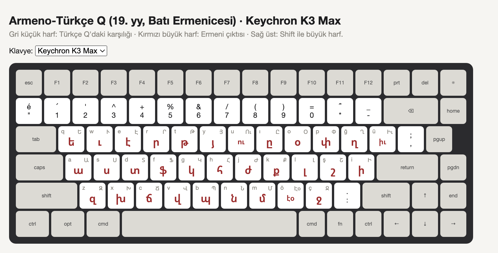

# Armeno-Türkçe Q

**English** · [Türkçe](README.tr.md)

A macOS keyboard layout for writing **Turkish in the Armenian script**, the way 19th-century Ottoman Armenian newspapers printed it (Armeno-Turkish). You type on a normal Turkish Q keyboard; Armenian letters come out.

> **Deneme metni yazıyorum.** → **տէնէմէ մէթնի յազըյօրում։**



*Gray: Turkish Q key · Red: Armenian output · Top right: Shift (capital)*

## Install

1. Download [`ArmenoTurkce.keylayout`](ArmenoTurkce.keylayout).
2. In Finder, press ⇧⌘G, go to `~/Library/Keyboard Layouts` and copy the file there.
3. Log out and log back in.
4. **System Settings → Keyboard → Text Input → Edit → +**, choose **Others → Armeno-Türkçe Q**.
5. Switch with the Globe (🌐) key or Ctrl+Space.

## Letter mapping

Letters use **Western Armenian** sound values, as Armeno-Turkish did. In Eastern Armenian, several of them read differently (e.g. տ is *t* there, *d* here).

| Turkish | Armenian | | Turkish | Armenian | | Turkish | Armenian |
|---|---|---|---|---|---|---|---|
| a | ա | | ı | ը | | r | ր |
| b | պ | | i | ի | | s | ս |
| c | ճ | | j | ժ | | ş | շ |
| ç | ջ | | k | ք | | t | թ |
| d | տ | | l | լ | | u | ու |
| e | է | | m | մ | | ü | իւ |
| f | ֆ | | n | ն | | v | վ |
| g | կ | | o | օ | | y | յ |
| ğ | ղ | | ö | էօ | | z | զ |
| h | հ | | p | փ | | | |

Extra keys: **x → խ** (the guttural *ḫ* of Arabic/Persian loanwords), **w → ւ**, **q → ե** (for period spellings like եա = *ya*).
ö, u and ü produce two Armenian letters from a single key.

## Punctuation

Armenian keeps its own punctuation. Each mark sits where its Turkish Q counterpart is; the Latin mark is one Option away.

| Key | Output | Latin mark |
|---|---|---|
| `.` | **։** full stop | Option + . |
| `:` (Shift + .) | **․** colon (mijaket, U+2024) | Shift+Option + . |
| `?` (Shift + *) | **՞** question mark | Shift+Option + * |
| `!` (Shift + 1) | **՜** exclamation | Option + 1 |
| Option + ö / ç | **« »** quotes | |
| Option + ş | **՝** pause (but) | |

In Armenian the question and exclamation marks go right after the word they apply to, not at the end of the sentence. In Turkish that is naturally the question particle: *yazabiliyor mu?* → **յազապիլիյօր մու՞։**

Other things to know:

- **Shift** and **Caps Lock** give capitals.
- **Cmd** and **Ctrl** shortcuts use Latin letters, so Cmd+C, Cmd+V and the rest work as usual.
- Digits and the remaining symbols follow Turkish Q.

## Keycap stickers

[`stickers.html`](stickers.html) shows the layout and prints keycap stickers at real size (mm). It has presets for the **Keychron K3 Max** and the **AULA F75**.

1. Measure the top of a keycap and set the size on the page.
2. Print with Cmd+P at 100% scale ("Fit to page" off).

## Building from source

The layout file is generated. To change a key, edit the tables in [`generate.py`](generate.py), then run:

```bash
python3 generate.py
```

It writes `ArmenoTurkce.keylayout` and runs a few self-checks. Copy the new file into `~/Library/Keyboard Layouts` and log out and back in.

## Limits

- The layout does not know word boundaries. Period spellings such as word-initial **եա** for *ya-* must be typed by hand with the q key.
- Newspapers differed in small ways (some used չ for *ç*). This layout follows the most common usage.
