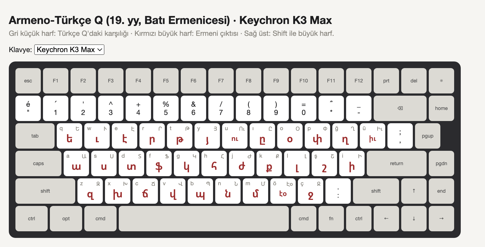

# Armeno-Türkçe Q

[English](README.md) · **Türkçe**

**Türkçeyi Ermeni harfleriyle** yazmak için bir macOS klavye düzeni. 19. yüzyıl Osmanlı Ermeni gazetelerinin kullandığı Ermeni harfli Türkçe (Armeno-Türkçe) yazımını esas alıyor. Normal Türkçe Q klavyede yazıyorsunuz, ekrana Ermeni harfleri çıkıyor.

> **Deneme metni yazıyorum.** → **տէնէմէ մէթնի յազըյօրում։**



*Gri: Türkçe Q tuşu · Kırmızı: Ermeni çıktısı · Sağ üst: Shift (büyük harf)*

## Kurulum

1. [`ArmenoTurkce.keylayout`](ArmenoTurkce.keylayout) dosyasını indirin.
2. Finder'da ⇧⌘G ile `~/Library/Keyboard Layouts` klasörüne gidin ve dosyayı oraya kopyalayın.
3. Oturumu kapatıp yeniden açın.
4. **Sistem Ayarları → Klavye → Metin Girişi → Düzenle → +** yolunu izleyin ve **Diğer → Armeno-Türkçe Q**'yu seçin.
5. Globe (🌐) tuşu ya da Ctrl+Boşluk ile geçiş yapın.

## Harf eşlemesi

Armeno-Türkçe gibi harfler de **Batı Ermenicesi** ses değerleriyle okunur. Doğu Ermenicesinde bazı harfler farklı okunur; örneğin տ orada *t*, burada *d*.

| Türkçe | Ermenice | | Türkçe | Ermenice | | Türkçe | Ermenice |
|---|---|---|---|---|---|---|---|
| a | ա | | ı | ը | | r | ր |
| b | պ | | i | ի | | s | ս |
| c | ճ | | j | ժ | | ş | շ |
| ç | ջ | | k | ք | | t | թ |
| d | տ | | l | լ | | u | ու |
| e | է | | m | մ | | ü | իւ |
| f | ֆ | | n | ն | | v | վ |
| g | կ | | o | օ | | y | յ |
| ğ | ղ | | ö | էօ | | z | զ |
| h | հ | | p | փ | | | |

Ek tuşlar: **x → խ** (Arapça/Farsça kökenli kelimelerdeki hırıltılı *ḫ*), **w → ւ**, **q → ե** (dönemin եա = *ya* gibi yazımları için).
ö, u ve ü tek tuşla iki Ermeni harfi yazar.

## Noktalama

Ermenice kendi noktalama işaretlerini kullanır. Her işaret, Türkçe Q'daki karşılığının yerinde; Latin işaret Option ile çıkıyor.

| Tuş | Çıktı | Latin işaret |
|---|---|---|
| `.` | **։** nokta | Option + . |
| `:` (Shift + .) | **․** iki nokta (micaket, U+2024) | Shift+Option + . |
| `?` (Shift + *) | **՞** soru işareti | Shift+Option + * |
| `!` (Shift + 1) | **՜** ünlem | Option + 1 |
| Option + ö / ç | **« »** tırnak | |
| Option + ş | **՝** hafif duraklama (but) | |

Ermenicede soru ve ünlem işaretleri cümle sonuna değil, ilgili kelimenin hemen arkasına gelir. Türkçede bu kelime doğal olarak soru ekidir: *yazabiliyor mu?* → **յազապիլիյօր մու՞։**

Bilinmesi gereken diğer noktalar:

- **Shift** ve **Caps Lock** büyük harf verir.
- **Cmd** ve **Ctrl** kısayolları Latin harfle çalışır; Cmd+C, Cmd+V ve diğerleri her zamanki gibi kullanılır.
- Rakamlar ve kalan işaretler Türkçe Q'daki gibidir.

## Tuş etiketleri

Yazdırmaya hazır A4 şablonlar (her birinde 47 etiket, kesik kesim çizgileri):

- [Keychron K3 Max (13 mm)](templates/keychron-k3-max.pdf)
- [AULA F75 (12,5 mm)](templates/aula-f75.pdf)

**%100 ölçekte** yazdırın ("Sığdır" kapalı), kesik çizgilerden kesin ve her etiketi sol üstteki gri harfin (Türkçe Q) tuşuna yapıştırın.

Başka bir klavye ya da tuş boyutu mu? [`stickers.html`](stickers.html) dosyasını tarayıcıda açın, tuşun üst yüzeyini ölçüp boyutu ayarlayın ve Cmd+P ile yazdırın.

## Kaynaktan derleme

Klavye dosyası bir betikle üretiliyor. Bir tuşu değiştirmek için [`generate.py`](generate.py) içindeki tabloları düzenleyip şunu çalıştırın:

```bash
python3 generate.py
```

Betik `ArmenoTurkce.keylayout` dosyasını yazar ve birkaç otomatik kontrol yapar. Yeni dosyayı `~/Library/Keyboard Layouts` klasörüne kopyalayıp oturumu kapatıp açın.

## Sınırlar

- Klavye kelime başını tanımaz. Kelime başındaki *ya-* için **եա** gibi dönem yazımlarını q tuşuyla elle yazmak gerekir.
- Gazeteler arasında küçük farklar vardı; örneğin bazıları *ç* için չ kullanıyordu. Bu düzen en yaygın kullanımı esas alıyor.
